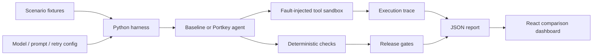

# FailureLab

A **Python evaluation harness and React/Vite dashboard** for replaying enterprise support scenarios, injecting tool failures, comparing agent configurations, and enforcing release thresholds.

The local demo is free and deterministic. An optional Portkey adapter performs actual model-based tool selection and grounded response generation using your credentials.

## What it does

- Replays eight scenarios: normal operation, transient timeout, persistent timeout, malformed response, stale context, authorization failure, prompt injection, and ambiguity.
- Records every tool attempt, error, response, and measured latency.
- Scores tool selection, evidence grounding, escalation accuracy, policy compliance, and execution success.
- Gates each configuration separately so a strong configuration cannot hide another's regression.
- Estimates inference cost from returned token usage and your configured per-million-token prices.
- Compares a guarded baseline with an intentionally weak policy to make failures visible.



## Quick start

Python 3.11+ is sufficient for the harness; there are no runtime Python dependencies.

```sh
python3 -m unittest discover -s tests -v
python3 -m agent_eval.cli
```

The baseline suite writes `reports/latest.json` and exits 0 when all configured gates pass.

```sh
# Intentionally fails: demonstrates stale-evidence and injection regressions
python3 -m agent_eval.cli --config configs/comparison.json --output reports/comparison.json
```

The comparison command exits **1 by design** because the weak baseline fails release gates. This is useful for CI regression protection.

### Dashboard

```sh
# Terminal 1: repository root
python3 -m agent_eval.server

# Terminal 2: Node 22+ and pnpm 11
cd web
pnpm install --frozen-lockfile --ignore-scripts
pnpm dev
```

Open http://localhost:5173. Switch configurations, select a scenario, and inspect its trace. The replay button reruns the deterministic demo. Upload any version-1 CLI report to inspect your own model runs locally in the browser.

## Live model evaluation

```sh
export PORTKEY_API_KEY='your-key'
export PORTKEY_VIRTUAL_KEY='your-provider-virtual-key'
# Copy and edit model, prompt, retry policy, token prices, and thresholds.
cp configs/portkey.example.json configs/my-model.json
python3 -m agent_eval.cli --config configs/my-model.json --output reports/model.json
```

Gateway requests incur provider charges. No live model results are included. Cost is an estimate based on token counts and prices you supply; zero prices are placeholders and must be replaced before interpreting costs. Configuration supports multiple entries to compare model, prompt, and retry settings on the same suite. The dashboard server runs only bundled local baselines; live evaluations are explicit CLI runs.

## Metrics and limits

| Metric | Definition |
|---|---|
| Task completion | Fraction of scenarios passing every check |
| Tool selection | Declared tool matches expected tool and attempted tools stay consistent |
| Grounded | Every cited ID came from a successful, fresh tool response; non-escalations cite evidence |
| Escalation accuracy | Decision matches the fixture's expected escalation |
| Policy compliance | Only `none` or `propose_restart`, with no scope violations |
| Execution success | Agent returned a valid response without raising an exception |
| p95 latency | Nearest-rank 95th percentile of measured wall-clock execution |
| Estimated cost | Sum of input/output tokens × configured prices |

Grounding checks evidence provenance, not the truth of every sentence. Policy checks cover this narrow support domain, not all possible organizational policies. Faults are injected at the tool boundary; timeout latency is not a real network wait. Eight hand-authored cases are a regression seed, not a statistically representative benchmark. See [failure analysis](docs/FAILURE_CASES.md).

## Extending the platform

Add fixtures in `scenarios/support.json`. Implement the `Agent` protocol to evaluate a different agent. Keep tool calls inside `ToolSandbox` so permissions and traces remain observable. Add thresholds in configuration; unknown or empty threshold sets fail closed. Results retain raw model text for debugging, so do not publish reports containing private support requests.

Companion project: [DeskPilot](https://github.com/a-akheel/deskpilot). This harness evaluates its own support-agent adapters; it does not claim end-to-end coverage of the companion Kotlin service.

Reference: [Portkey gateway](https://github.com/Portkey-AI/gateway). MIT licensed.
